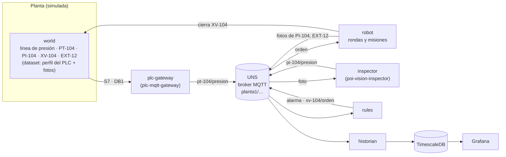

# Industrial UNS demo

[](https://github.com/aseinotegi/industrial-uns-demo/actions/workflows/ci.yml)


[English](README.md) · **Español**

Un **Unified Namespace** para una planta pequeña, que arranca en tu portátil con un solo comando. Un robot fotografía un manómetro y un extintor, un modelo multimodal lee las fotos, el transmisor de un PLC publica la misma presión, una regla los cruza, el robot cierra una válvula manual y todo acaba en un histórico con su dashboard.

Es la historia que se cuenta en [andersein.com](https://andersein.com), funcionando. Sin hardware, sin nube y con protocolos reales.



## Arranque rápido

```bash
docker compose up --build
```

Abre **http://localhost:3000** (Grafana, sin usuario). Cada tres minutos la presión de la línea sube de 4,2 hacia 6,8 bar, siguiendo [dataset/plc/linea-104.csv](dataset/plc/linea-104.csv). En menos de un minuto verás la alarma confirmada por las dos fuentes, al robot cerrando la XV-104 y la presión volviendo a su sitio.

¿Demasiado lento para echar un vistazo? Con `WORLD_TIME_SCALE=0.25 ROBOT_ROUND_S=4 docker compose up --build` la historia completa pasa en menos de un minuto.

El namespace en este momento:

```text
$ docker compose run --rm tree
planta1/
  exterior/
    pi-104/
      presion                 6.50 bar   (inspector, 94%)
    pt-104/
      alarma-alta             True
      presion                 6.00 bar
    reglas/
      sobrepresion-linea-104  activa   (rules)
    xv-104/
      estado                  cerrada   (robot-01)
  robots/
    robot-01/
      mision                  completada   (robot-01)
  servicios/
    historian                 online   (historian)
    ...
```

Y lo que guarda el histórico de una alarma, de principio a fin (salida real de una ejecución):

```text
16:28:54.920 | planta1/robots/robot-01/foto                   | IMG_0413
16:28:54.924 | planta1/exterior/reglas/sobrepresion-linea-104 | activa
16:28:54.924 | planta1/exterior/xv-104/orden                  | cerrar
16:28:54.926 | planta1/robots/robot-01/mision                 | en-camino
16:28:57.428 | planta1/exterior/xv-104/estado                 | cerrada
16:28:57.429 | planta1/robots/robot-01/mision                 | completada
16:28:58.381 | planta1/exterior/reglas/sobrepresion-linea-104 | normal
```

## La historia, servicio a servicio

| Paso | Servicio | Qué hace |
|---|---|---|
| 1 | `robot` | En cada ronda se para en el manómetro local **PI-104** (una esfera sin señal) y en el extintor **EXT-12**, y hace una foto a cada uno |
| 2 | `inspector` | [poi-vision-inspector](https://github.com/aseinotegi/poi-vision-inspector) lee cada foto con un modelo multimodal: valor, confianza y sus propias comprobaciones. Las fotos dudosas se publican con `quality: uncertain` y las ilegibles nunca pisan el último valor |
| 3 | `plc-gateway` | Lee el transmisor **PT-104** del PLC Siemens S7 y lo publica en su ruta del UNS |
| 4 | `rules` | Visión **y** PLC por encima de 6 bar, los dos recientes → alarma confirmada y orden `cerrar` para la XV-104 |
| 5 | `robot` | Va a la válvula manual **XV-104** (sin actuador) y la cierra. Publica la nueva posición |
| 6 | `historian` | Guarda cada valor y cada evento en TimescaleDB. Grafana enseña el pico, la alarma y el cierre |

`world` hace de planta física. Lleva la línea de presión, el PLC (un servidor S7 de verdad en el puerto 1102), lo que ve la cámara del robot, la válvula y el extintor. Es lo único que en la vida real no es software.

Las reglas también vigilan el extintor. Si el robot ve el EXT-12 fuera de su sitio o sin presión, `extintor-ext-12` da un aviso (sin orden).

## El dataset

Lo que "hace" la planta sale de archivos. Así todas las ejecuciones cuentan la misma historia y es fácil cambiarla:

- [dataset/plc/linea-104.csv](dataset/plc/linea-104.csv): la presión de la línea durante un ciclo con la XV-104 abierta. El PLC la publica con un poco de ruido eléctrico. Si se cierra la válvula baja a 4,2 bar, diga lo que diga el perfil.
- [dataset/fotos.csv](dataset/fotos.csv) y [dataset/fotos/](dataset/fotos): 19 fotos con su valor real. 15 del PI-104, cada 0,25 bar de 4,0 a 7,0 (dos con reflejo o desenfoque, como le pasa a una cámara en exterior), y 4 del EXT-12 (correcto, sin presión, ausente). En cada ronda la cámara entrega la foto más cercana a lo que marca la esfera, así que la foto y el PLC siempre cuadran.

Las fotos son sintéticas, hechas con el generador de poi-vision-inspector (`python scripts/make_dataset.py`). Se pueden cambiar por fotos reales sin tocar código: se deja el archivo en `dataset/fotos` y se añade su línea, con el valor leído, en `fotos.csv`.

### Qué modelo lee las fotos

| | Modelo | Para |
|---|---|---|
| `config/inspector.yaml` (por defecto) | ninguno: respuestas grabadas ([respuestas-de-prueba.json](dataset/respuestas-de-prueba.json)), escritas desde los valores reales. Cada resultado dice `model: replay` | la CI y un primer arranque sin instalar nada |
| `config/inspector.ollama.yaml` | `qwen3-vl` en [Ollama](https://ollama.com), en tu PC (usa su GPU) | lo de verdad, sin que nada salga de la máquina |

```bash
ollama pull qwen3-vl
INSPECTOR_CONFIG=inspector.ollama.yaml ROBOT_ROUND_S=30 docker compose up --build
```

Un modelo local tarda unos segundos por foto (más sin GPU), así que conviene darle al robot tiempo entre rondas con `ROBOT_ROUND_S`.

## El namespace

Una sola jerarquía, `planta/área/equipo/dato`, con los nombres del P&ID de la planta (en castellano, como en planta; el código va en inglés):

| Topic | Lo publica | Retenido | Ejemplo |
|---|---|---|---|
| `planta1/exterior/pi-104/presion` | inspector | sí | `6.75` bar, confianza 0,94 |
| `planta1/exterior/pi-104/presion/inspeccion` | inspector | sí | la inspección completa: comprobaciones, modelo, prompt y hash de la imagen |
| `planta1/exterior/ext-12/estado` | inspector | sí | `OK` / `NOK`, con el motivo |
| `planta1/exterior/pt-104/presion` | plc-gateway | sí | `6.71` bar |
| `planta1/exterior/pt-104/alarma-alta` | plc-gateway | sí | `true` (el bit del propio PLC) |
| `planta1/exterior/reglas/<regla>` | rules | sí | `activa` / `normal`, con los valores que decidieron |
| `planta1/exterior/xv-104/orden` | rules | **no** | `cerrar` |
| `planta1/exterior/xv-104/estado` | robot | sí | `abierta` / `cerrada` |
| `planta1/robots/robot-01/foto` | robot | no | `IMG_0412`, con `poi` e `image_url` |
| `planta1/robots/robot-01/mision` | robot | sí | `en-camino` / `completada` |
| `planta1/servicios/<servicio>` | cada servicio | sí | `online` / `offline` (Last Will) |

Todos los mensajes siguen el mismo contrato. Solo `value` es obligatorio y los campos extra se conservan:

```json
{"value": 6.8, "unit": "bar", "ts": "2026-11-18T15:28:54.920Z",
 "source": "inspector", "quality": "good", "confidence": 0.94, "model": "qwen3-vl"}
```

## Reglas

YAML normal y corriente, que puede leer quien lleva la planta ([config/rules.yaml](config/rules.yaml)):

```yaml
- id: sobrepresion-linea-104
  mode: act                 # notify: solo alarma · act: alarma y órdenes
  when:                     # todas, y cada una reciente
    - { topic: planta1/exterior/pi-104/presion, above: 6.0, max_age_s: 45, quality: good }
    - { topic: planta1/exterior/pt-104/presion, above: 6.0, max_age_s: 30 }
  clear_when:               # histéresis: se limpia por debajo de 5,5, no de 6,0
    - { topic: planta1/exterior/pt-104/presion, below: 5.5 }
  on_trigger:
    - { topic: planta1/exterior/xv-104/orden, value: cerrar }
```

## Decisiones de diseño

- **El UNS es la única interfaz.** Ningún servicio llama a otro. El inspector no sabe que existen las reglas, y las reglas no saben que el valor viene de una cámara. Meter un segundo robot o una tercera planta es publicar en una rama nueva.
- **Dos fuentes antes de actuar.** Una foto mala o un transmisor con ruido nunca mandan al robot. Las fotos dudosas se publican, para que el dashboard las pueda enseñar, pero las reglas piden `quality: good`.
- **La frescura la mide quien recibe.** `max_age_s` usa el reloj del motor de reglas al llegar el valor, no la hora del mensaje, así que un equipo con la hora mal no puede colar un valor viejo como nuevo. Los valores retenidos son historia y nunca disparan una regla.
- **Las órdenes no se retienen.** Los estados sí (quien se conecta tarde ve la foto actual), las órdenes no. Un robot que se reinicia no puede repetir el `cerrar` de ayer.
- **Salta una vez y se limpia con margen.** Una regla activa no vuelve a saltar hasta que se limpia, y se limpia a 5,5 bar, no a 6,0. Así no hay ráfagas de órdenes alrededor del límite.
- **Primero avisar, luego actuar.** Mismo fichero y una sola palabra. Así es como una acción automática se gana la confianza en planta.
- **Reutilizar, no copiar.** La parte del PLC es [plc-mqtt-gateway](https://github.com/aseinotegi/plc-mqtt-gateway), construida directamente desde su repositorio. Su opción `topic` por variable deja el valor del PLC en su ruta del UNS.
- **Un histórico que aguanta reinicios.** Inserta por lotes (una transacción por segundo), guarda las filas en memoria mientras la base de datos se reinicia y crea el esquema al arrancar. Usa hypertables si hay TimescaleDB y tablas normales en PostgreSQL a secas.

## Estructura

```text
src/uns_demo/
  uns.py        el namespace y el contrato de mensajes
  bus.py        MQTT para todos los servicios: estado con Last Will, suscripciones con o sin retenidos
  world.py      planta simulada: perfil del PLC, PLC S7 (DB1), cámara desde el dataset, válvula
  robot.py      rondas y misiones
  rules.py      reglas en YAML, motor puro (entran mensajes, salen mensajes)
  historian.py  UNS → TimescaleDB, por lotes y tolerante a caídas
  tree.py       pinta el namespace
config/         reglas, variables de la pasarela, inspector (replay / Ollama), broker
dataset/        fotos con su valor real, perfil de presión del PLC, respuestas grabadas
grafana/        fuente de datos y dashboard, provisionados
scripts/        prueba de extremo a extremo (la usa la CI), generador del dataset
```

## Tests

```bash
pip install -e ".[dev]"
pytest -q                  # 59 tests, sin broker ni base de datos
./scripts/smoke-test.sh    # todo el stack en Docker, comprobado de punta a punta
```

La CI pasa los tests en Python 3.10–3.13 y después levanta el `docker compose` completo. Espera hasta que la base de datos tenga la cadena entera: alarma, orden, válvula cerrada y alarma limpia.

## Parte de una serie

| Repositorio | Papel en la historia |
|---|---|
| [plc-mqtt-gateway](https://github.com/aseinotegi/plc-mqtt-gateway) | PLC → MQTT, aquí para el PT-104 |
| [robot-fleet-watchdogs](https://github.com/aseinotegi/robot-fleet-watchdogs) | Reglas y watchdogs para una flota de robots real |
| [andersein.com](https://andersein.com) | La historia, dibujada |

---

Licencia MIT · [Ander Sein](https://andersein.com) · [aseinotegi@gmail.com](mailto:aseinotegi@gmail.com)
