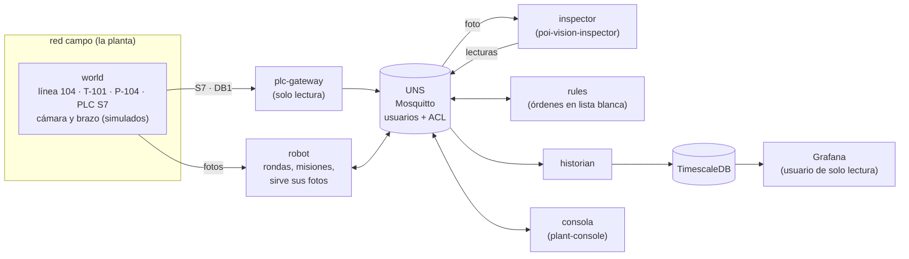

# Industrial UNS demo

[](https://github.com/aseinotegi/industrial-uns-demo/actions/workflows/ci.yml)


[English](README.md) · **Español**

Un **Unified Namespace** para una planta pequeña, funcionando en tu portátil con un comando. Un robot de inspección recorre la planta y fotografía manómetros y extintores, un modelo multimodal lee las fotos, un PLC Siemens S7 publica el proceso, una regla cruza visión y PLC, el robot cierra una válvula manual y todo acaba en un histórico. Una consola web lo enseña en directo, y la red está segmentada y cerrada como debería estarlo en una planta.

Es la historia que cuenta [andersein.com](https://andersein.com), funcionando: sin hardware, sin nube, con protocolos reales.




## Arranque rápido

```bash
docker compose up --build
```

Abre **http://localhost:8000**, la consola de la planta ([plant-console](https://github.com/aseinotegi/plant-console)): el plano con el robot recorriendo su ruta, las señales del PLC, lo que ha leído la visión con cada foto, un constructor de reglas, el namespace, el MQTT en directo, el histórico (Grafana, dentro de la consola), la arquitectura y los controles de ciberseguridad.

Cada seis minutos la presión que entra en la línea 104 sube de 4,2 hacia 6,8 bar, siguiendo [dataset/plc/linea-104.csv](dataset/plc/linea-104.csv). En su siguiente pasada el robot fotografía el manómetro PI-104, la visión y el transmisor del PLC coinciden, la regla salta, el robot va a la XV-104, la cierra y la presión baja.

¿Demasiado lento para un primer vistazo? Todo cuatro veces más rápido:

```bash
WORLD_TIME_SCALE=0.25 ROBOT_SPEED=6 ROBOT_ACCEL=9.6 ROBOT_DWELL_S=0.75 ROBOT_ACTION_S=1 ROBOT_CHARGE_RATE=12 docker compose up --build
```

El botón **Provocar sobrepresión** de la consola lanza una subida de presión en el momento en vez de esperar a la siguiente. Para volver a las reglas de partida: `docker compose down -v`.

## La planta

[config/planta.yaml](config/planta.yaml) es el plano: edificios, pasillos, tuberías y equipos, en metros. El robot lo recorre y la consola lo dibuja, así que lo que ves es donde está el robot.

```text
colector ─▶ XV-104 ─▶ PI-104 · PT-104 · FT-104 · TT-104 ─▶ T-101 (LT-101) ─▶ P-104 ─▶ unidad 2
```

| Dónde | Qué | Cómo se lee |
|---|---|---|
| Línea 104 | válvula manual **XV-104** (sin actuador ni final de carrera) | el robot la comprueba y la cierra |
| Línea 104 | manómetro **PI-104** (una esfera, sin señal) | foto del robot + visión |
| Línea 104 | presión **PT-104**, caudal **FT-104**, temperatura **TT-104** | PLC (S7, DB1) |
| Parque de tanques | depósito **T-101**, nivel **LT-101**, bomba **P-104** (marcha, corriente del motor, arranques) | PLC. El PLC arranca la bomba al 70 % y la para al 35 % |
| Subestación | presión-vacío **PIV-801** del transformador TR-1 | foto del robot + visión |
| Sala de calderas | termomanómetro **PI-201** | foto del robot + visión |
| Rack de tuberías | manómetro del colector de nitrógeno **PI-610** | foto del robot + visión |
| Taller | manómetro viejo **PI-402**, ilegible a propósito | el modelo tiene que decir "no legible", no inventar |
| Sala de control, bombeo | extintores **EXT-14** y **EXT-12** | foto del robot + visión (en su soporte o no) |

El robot (`robot-01`) acelera y frena, va más despacio en las curvas, gasta batería por metro y carga en su base cuando le queda poca. Su ronda es más corta que un pico de presión, así que siempre llega a tiempo al PI-104.

`world` hace de planta física: el proceso, el PLC (un servidor S7 de verdad), lo que ve la cámara y la válvula. Es lo único que en la vida real no es software, y solo está en la red de campo.

## El dataset

- [dataset/plc/linea-104.csv](dataset/plc/linea-104.csv): la presión de entrada durante un ciclo. Caudal, nivel, bomba y temperatura salen de ella con física sencilla.
- [dataset/fotos/](dataset/fotos) y [fotos.csv](dataset/fotos.csv): 23 fotos con su valor real.
  - **Fotos reales** de Wikimedia Commons (CC BY, CC BY-SA, CC0), una por punto de la ronda, leídas a mano. Autores y licencias en [dataset/fotos/CREDITOS.md](dataset/fotos/CREDITOS.md) y junto a cada foto en la consola.
  - **PI-104**, el manómetro que tiene que moverse con la línea, sigue siendo generado: 15 fotos cada 0,25 bar de 4,0 a 7,0, dos con reflejo o desenfoque. La cámara entrega la más cercana a lo que marca la esfera, así que la foto y el PLC siempre cuadran.

`python scripts/make_dataset.py --originales <carpeta>` lo reconstruye: redimensiona los originales y escribe los valores reales, los créditos y las respuestas grabadas.

### Qué modelo lee las fotos

| | Modelo | Para |
|---|---|---|
| `config/inspector.yaml` (por defecto) | ninguno: respuestas grabadas ([respuestas-de-prueba.json](dataset/respuestas-de-prueba.json)), escritas desde los valores reales. Cada resultado dice `model: replay` | CI y un primer arranque sin instalar nada |
| `config/inspector.ollama.yaml` | `qwen3-vl` en [Ollama](https://ollama.com) en tu PC (usa su GPU) | lo de verdad, nada sale de la máquina |

```bash
ollama pull qwen3-vl
INSPECTOR_CONFIG=inspector.ollama.yaml ROBOT_DWELL_S=15 docker compose up --build
```

## El namespace

Una jerarquía, `planta/área/equipo/dato`, con los nombres del P&ID de la planta (en castellano, como en planta; el código en inglés):

| Tema | Lo publica | Retenido | Ejemplo |
|---|---|---|---|
| `planta1/exterior/pt-104/presion`, `ft-104/caudal`, `tt-104/temperatura` | plc-gateway | sí | `6.71` bar, `42.5` m3/h, `39.2` °C |
| `planta1/exterior/pt-104/alarma-alta` | plc-gateway | sí | `true` (el bit del propio PLC) |
| `planta1/tanques/lt-101/nivel`, `p-104/marcha`, `p-104/corriente`, `p-104/arranques` | plc-gateway | sí | `62` %, `true`, `21.5` A, `12` |
| `planta1/<área>/<equipo>/<dato>` de cada punto de la ronda | inspector | sí | `6.75` bar, `OK` / `NOK`, con calidad y confianza |
| `…/inspeccion` debajo de cada uno | inspector | sí | la inspección entera: comprobaciones, modelo, prompt y hash de la imagen |
| `planta1/reglas/<regla>` | rules | sí | `activa` / `normal`, con los valores que decidieron |
| `planta1/exterior/xv-104/orden` | rules | **no** | `cerrar` |
| `planta1/exterior/xv-104/estado` | robot | sí | `abierta` / `cerrada` |
| `planta1/robots/robot-01/foto` | robot | no | `IMG_0412`, con `poi` e `image_url` |
| `planta1/robots/robot-01/posicion` | robot | sí | estado, `x`, `y`, `rumbo`, `velocidad`, `bateria` (5 por segundo, no se guarda) |
| `planta1/robots/robot-01/mision` | robot | sí | `en-camino` / `completada` |
| `planta1/servicios/<servicio>` | cada servicio | sí | `online` / `offline` (Last Will) |
| `planta1/servicios/rules/config` | rules | sí | las reglas que está aplicando y las órdenes permitidas |
| `planta1/simulacion/…` | simulador | | solo de la demo: el escenario y el botón |

Todos los mensajes siguen un contrato. Solo `value` es obligatorio y los campos extra se conservan:

```json
{"value": 6.8, "unit": "bar", "ts": "2026-11-18T15:28:54.920Z",
 "source": "inspector", "quality": "good", "confidence": 0.94, "model": "qwen3-vl"}
```

## Reglas

Se montan en la consola con las variables del UNS, o se escriben a mano ([config/rules.yaml](config/rules.yaml) es el punto de partida):

```yaml
- id: sobrepresion-linea-104
  mode: act                 # notify: solo alarma · act: alarma + órdenes
  when:                     # todas, cada una suficientemente reciente
  - {topic: planta1/exterior/pi-104/presion, above: 6.0, max_age_s: 45, quality: good}
  - {topic: planta1/exterior/pt-104/presion, above: 6.0, max_age_s: 30}
  clear_when:               # histéresis: se rearma por debajo de 5,5, no de 6,0
  - {topic: planta1/exterior/pt-104/presion, below: 5.5}
  on_trigger:
  - {topic: planta1/exterior/xv-104/orden, value: cerrar}
```

Las reglas viajan por el UNS. El motor publica las que aplica en `planta1/servicios/rules/config` y recibe las nuevas en `…/config/set` (solo el usuario de la consola puede publicar ahí). Las valida, las guarda en su volumen y contesta. Una regla solo puede dar órdenes de `RULES_ORDERS`, una lista blanca que vive fuera de las reglas: quien las edita no puede inventarse una orden nueva para la planta.

## Ciberseguridad

La demo aplica lo básico de IEC 62443 a escala de portátil, y la página **Ciberseguridad** de la consola prueba dos de los controles en directo.

- **Zonas.** Cuatro redes de Docker: `campo` (la planta y su PLC), `uns` (broker y servicios), `datos` (la base de datos) y `publica`. El PLC solo está en `campo`; `campo` y `datos` no tienen salida. Robot, pasarela del PLC y puente del simulador son los únicos que están a los dos lados, y cada uno solo deja pasar lo suyo.
- **Identidad.** Sin MQTT anónimo. Un usuario por servicio, con las contraseñas guardadas con hash en el broker al arrancar.
- **Mínimo privilegio.** Una ACL por usuario ([config/mosquitto/acl](config/mosquitto/acl)): cada servicio solo escribe sus temas. La consola solo puede leer, más dos peticiones: reglas nuevas y el botón de la demo. No puede mandar una orden a la planta, y la propia consola lo demuestra.
- **Validación de lo que entra.** El motor valida las reglas y las órdenes salen de la lista blanca.
- **Lo mínimo para funcionar.** Contenedores sin capacidades de Linux, sin escalada de privilegios y, los nuestros, con el sistema de ficheros en solo lectura. La pasarela del PLC no sabe escribir.
- **Histórico intocable.** Grafana lee con un usuario de base de datos que solo puede hacer `SELECT`.
- **Expuesto:** solo la consola (8000) y Grafana (3000). El broker solo en `127.0.0.1:1883`, para [MQTT Explorer](https://mqtt-explorer.com) con el usuario de solo lectura `explorer` / `explorer`.

Falta, para el servidor público: TLS, secretos fuera del repositorio (las contraseñas de aquí son de demo, en `config/mosquitto/passwords` y `docker-compose.yml`) y registros de auditoría centralizados. El CI comprueba el resto en cada push: acceso anónimo rechazado, una orden desde la consola descartada y Grafana sin poder borrar el histórico.

## Decisiones de diseño

- **El UNS es la única interfaz.** Ningún servicio llama a otro. El inspector no sabe que existen las reglas; las reglas no saben que el valor vino de una cámara. Añadir un segundo robot o una tercera planta es publicar en una rama nueva.
- **Dos fuentes antes de actuar.** Una foto mala o un transmisor con ruido nunca mandan al robot. Las fotos dudosas se publican, pero las reglas exigen `quality: good`.
- **La frescura la mide quien recibe.** `max_age_s` usa el reloj del motor al llegar el valor, no el `ts` del mensaje: un equipo con la hora mal no puede hacer pasar un valor viejo por reciente. Los retenidos son historia y nunca disparan una regla.
- **Las órdenes no se retienen.** Los estados sí (quien llega tarde ve la foto actual), las órdenes no: un robot que se reinicia no debe repetir el `cerrar` de ayer.
- **Dispara una vez, rearma con margen.** Una regla activa no vuelve a disparar hasta rearmarse, y se rearma a 5,5 bar, no a 6,0. Guardar las reglas mantiene activa la que lo estaba, así que nunca repite una orden.
- **Primero avisar, luego actuar.** La misma regla, una palabra. Así se gana la confianza para automatizar en planta.
- **Reutilizar, no copiar.** El lado del PLC es [plc-mqtt-gateway](https://github.com/aseinotegi/plc-mqtt-gateway), la visión [poi-vision-inspector](https://github.com/aseinotegi/poi-vision-inspector) y la consola [plant-console](https://github.com/aseinotegi/plant-console), construidos directamente desde sus repositorios.
- **Un histórico que aguanta reinicios.** Inserciones por lotes, filas en memoria mientras la base de datos se reinicia, esquema creado al arrancar. Las inspecciones se guardan enteras, como eventos.

## Estructura

```text
src/uns_demo/
  uns.py        el namespace y el contrato de mensajes
  bus.py        MQTT para todos los servicios: usuario, estado con Last Will, retenidos o solo en vivo
  world.py      planta simulada: proceso, PLC S7 (DB1), cámara desde el dataset, válvula
  plant.py      plano de la planta y geometría de la ruta (config/planta.yaml)
  robot.py      recorre la ruta, fotos, misiones, batería; sirve sus fotos y su plano
  sim.py        controles de la demo (escenario, perturbación) a través del UNS
  rules.py      motor de reglas: evaluación pura, lista blanca, reglas por MQTT
  historian.py  UNS → TimescaleDB, por lotes y resistente
  tree.py       imprime el namespace
config/         plano, reglas, variables de la pasarela, inspector (replay / Ollama), usuarios y ACL del broker
dataset/        fotos con su valor real y sus créditos, perfil de presión del PLC, respuestas grabadas
grafana/        origen de datos y panel, aprovisionados
scripts/        prueba de punta a punta (la usa el CI), generador del dataset
```

## Tests

```bash
pip install -e ".[dev]"
pytest -q                  # 89 tests, sin broker ni base de datos
./scripts/smoke-test.sh    # todo el stack en Docker, comprobado de punta a punta
```

El CI pasa los tests en Python 3.10–3.13 y después levanta el `docker compose` completo: espera a que la base de datos tenga la cadena entera (alarma, orden, válvula cerrada, alarma rearmada) y luego comprueba los controles de seguridad.

## Parte de una serie

| Repositorio | Papel en la historia |
|---|---|
| [plant-console](https://github.com/aseinotegi/plant-console) | La consola web de esta planta |
| [poi-vision-inspector](https://github.com/aseinotegi/poi-vision-inspector) | Lee las fotos del robot |
| [plc-mqtt-gateway](https://github.com/aseinotegi/plc-mqtt-gateway) | PLC → MQTT |
| [robot-fleet-watchdogs](https://github.com/aseinotegi/robot-fleet-watchdogs) | Reglas y watchdogs para una flota real de robots |
| [andersein.com](https://andersein.com) | La historia, dibujada |

---

Licencia MIT · [Ander Sein](https://andersein.com) · [aseinotegi@gmail.com](mailto:aseinotegi@gmail.com). Las fotos reales conservan su propia licencia ([créditos](dataset/fotos/CREDITOS.md)).
