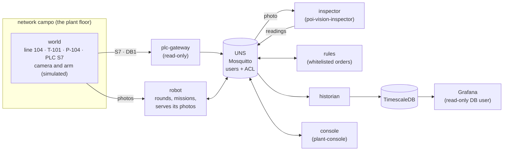

# Industrial UNS demo

[](https://github.com/aseinotegi/industrial-uns-demo/actions/workflows/ci.yml)


**English** · [Español](README.es.md)

A **Unified Namespace** for a small plant, running on your laptop with one command. An inspection robot walks the plant and photographs gauges and extinguishers, a multimodal model reads the photos, a Siemens S7 PLC publishes the process, a rule cross-checks vision and PLC, the robot closes a manual valve, and everything ends up in a historian. A web console shows it all live, and the network is segmented and locked down the way a plant should be.

It is the story told on [andersein.com](https://andersein.com), working: no hardware, no cloud, real protocols.




## Quick start

```bash
docker compose up --build
```

Open **http://localhost:8000**, the plant console ([plant-console](https://github.com/aseinotegi/plant-console)): the plant map with the robot walking its route, the PLC signals, the vision results with each photo, a rule builder, the namespace, a live MQTT view, the history (Grafana, embedded), the architecture and the security controls.

Every six minutes the pressure coming into line 104 rises from 4.2 towards 8 bar, following [dataset/plc/linea-104.csv](dataset/plc/linea-104.csv). On its next pass the robot photographs gauge PI-104, the vision reading and the PLC transmitter agree, the rule fires, the robot walks to XV-104, closes it and the pressure falls back.

Too slow for a first look? Run everything four times faster:

```bash
WORLD_TIME_SCALE=0.25 ROBOT_SPEED=6 ROBOT_ACCEL=9.6 ROBOT_DWELL_S=0.75 ROBOT_ACTION_S=1 ROBOT_CHARGE_RATE=12 docker compose up --build
```

The **Provocar sobrepresión** button in the console starts a pressure surge right away instead of waiting for the next one. To start over with the shipped rules: `docker compose down -v`.

## The plant

[config/planta.yaml](config/planta.yaml) is the map: buildings, walkways, pipes and equipment, in metres. The robot walks it and the console draws it, so what you see is where the robot is.

```text
header ─▶ XV-104 ─▶ PI-104 · PT-104 · FT-104 · TT-104 ─▶ T-101 (LT-101) ─▶ P-104 ─▶ unit 2
```

| Where | What | How it is read |
|---|---|---|
| Line 104 | manual valve **XV-104** (no actuator, no position switch) | the robot checks it and closes it |
| Line 104 | gauge **PI-104** (a dial, no signal) | robot photo + vision |
| Line 104 | pressure **PT-104**, flow **FT-104**, temperature **TT-104** | PLC (S7, DB1) |
| Tank farm | tank **T-101**, level **LT-101**, pump **P-104** (run, motor current, starts) | PLC. The PLC runs the pump on the level: start at 70 %, stop at 35 % |
| Substation | vacuum/pressure gauge **PIV-801** on transformer TR-1 | robot photo + vision |
| Boiler room | thermomanometer **PI-201** | robot photo + vision |
| Pipe rack | nitrogen header gauge **PI-610** | robot photo + vision |
| Workshop | old worn gauge **PI-402**, unreadable on purpose | the model must say "no legible", not guess |
| Control room, pumps | extinguishers **EXT-14**, **EXT-12** | robot photo + vision (on its bracket or not) |

The robot (`robot-01`) speeds up and slows down, slows at turns, spends battery per metre and charges at its base when it is low. Its round is shorter than a pressure peak, so it always gets to PI-104 in time.

`world` plays the physical plant: the process, the PLC (a real S7 server), what the camera sees and the valve. It is the only thing that is not software in real life, and it lives on the field network only.

## The dataset

- [dataset/plc/linea-104.csv](dataset/plc/linea-104.csv): the incoming pressure over one cycle. Flow, level, pump and temperature follow from it with simple physics.
- [dataset/fotos/](dataset/fotos) and [fotos.csv](dataset/fotos.csv): 10 photos from Wikimedia Commons (CC BY, CC BY-SA, CC0), with their true value read by hand. Authors and licences are in [dataset/fotos/CREDITOS.md](dataset/fotos/CREDITOS.md) and next to each photo in the console.
  - **PI-104**, the gauge that has to follow the line, has two: one at 5.3 bar and one at 8 bar, with a small gauge beside it: the big one is read and the small one is located apart. The camera hands over the one on the same side of the 6 bar alarm as the dial.
- [respuestas-de-prueba.json](dataset/respuestas-de-prueba.json): what Gemini answered about each photo, box included, recorded with `python3 scripts/grabar-respuestas.py`. The robot's round replays them, mistakes included.

To add a photo: put it in `dataset/fotos/`, add its row to `fotos.csv` and its credit to `CREDITOS.md`, and record its answer.

### Which model reads the photos

| | Model | For |
|---|---|---|
| `config/inspector.yaml` (default) | none: recorded answers ([respuestas-de-prueba.json](dataset/respuestas-de-prueba.json)), written from the true values. Every result says `model: replay` | CI, a first run with nothing to install |
| `config/inspector.ollama.yaml` | `qwen3-vl` in [Ollama](https://ollama.com) on your PC (uses its GPU) | the real thing, nothing leaves the machine |
| `config/inspector.gemini.yaml` | Gemini Flash, in the cloud, with a free [Google AI Studio](https://aistudio.google.com/apikey) key | a real model on a PC without a GPU. On the free tier Google may use the photos to improve its products |

```bash
ollama pull qwen3-vl
INSPECTOR_CONFIG=inspector.ollama.yaml ROBOT_DWELL_S=15 docker compose up --build
```

For Gemini, copy [.env.example](.env.example) to `.env`, paste the key in `GEMINI_API_KEY` and run `docker compose up --build`: compose reads `.env` on its own, and git ignores it.

## The namespace

One hierarchy, `site/area/device/value`, named like the plant's P&ID (in Spanish, as in the plant; the code is in English):

| Topic | Published by | Retained | Example value |
|---|---|---|---|
| `planta1/exterior/pt-104/presion`, `ft-104/caudal`, `tt-104/temperatura` | plc-gateway | yes | `6.71` bar, `42.5` m3/h, `39.2` °C |
| `planta1/exterior/pt-104/alarma-alta` | plc-gateway | yes | `true` (the PLC's own bit) |
| `planta1/tanques/lt-101/nivel`, `p-104/marcha`, `p-104/corriente`, `p-104/arranques` | plc-gateway | yes | `62` %, `true`, `21.5` A, `12` |
| `planta1/<area>/<device>/<value>` of each point of the round | inspector | yes | `6.75` bar, `OK` / `NOK`, with quality and confidence |
| `…/inspeccion` under each of them | inspector | yes | the whole inspection: checks, model, prompt and image hash |
| `planta1/reglas/<rule>` | rules | yes | `activa` / `normal`, with the inputs that decided |
| `planta1/exterior/xv-104/orden` | rules | **no** | `cerrar` |
| `planta1/exterior/xv-104/estado` | robot | yes | `abierta` / `cerrada` |
| `planta1/robots/robot-01/foto` | robot | no | `IMG_0412`, with `poi` and `image_url` |
| `planta1/robots/robot-01/posicion` | robot | yes | state, `x`, `y`, `rumbo`, `velocidad`, `bateria` (5 per second, not stored) |
| `planta1/robots/robot-01/mision` | robot | yes | `en-camino` / `completada` |
| `planta1/servicios/<service>` | each service | yes | `online` / `offline` (Last Will) |
| `planta1/servicios/rules/config` | rules | yes | the rules it is running, and the allowed orders |
| `planta1/simulacion/…` | simulador | | demo only: the scenario and the disturbance button |

Every message follows one contract. Only `value` is mandatory, extra fields are kept:

```json
{"value": 7.9, "unit": "bar", "ts": "2026-11-18T15:28:54.920Z",
 "source": "inspector", "quality": "good", "confidence": 0.94, "model": "qwen3-vl"}
```

## Rules

Built in the console from the variables of the UNS, or written by hand ([config/rules.yaml](config/rules.yaml) is the starting point):

```yaml
- id: sobrepresion-linea-104
  mode: act                 # notify: alarm only · act: alarm + orders
  when:                     # all of them, each one recent enough
  - {topic: planta1/exterior/pi-104/presion, above: 6.0, max_age_s: 45, quality: good}
  - {topic: planta1/exterior/pt-104/presion, above: 6.0, max_age_s: 30}
  clear_when:               # hysteresis: clears below 5.5, not 6.0
  - {topic: planta1/exterior/pt-104/presion, below: 5.5}
  on_trigger:
  - {topic: planta1/exterior/xv-104/orden, value: cerrar}
```

The rules travel through the UNS. The engine publishes the ones it runs on `planta1/servicios/rules/config` and takes new ones on `…/config/set` (only the console's user may publish there). It validates them, keeps them in its volume and answers. A rule can only send orders from `RULES_ORDERS`, a whitelist that lives outside the rules: whoever edits them cannot invent a new command for the plant.

## Security

The demo applies the basics of IEC 62443 at laptop scale, and the console's **Ciberseguridad** page tests two of them live.

- **Zones.** Four Docker networks: `campo` (the plant and its PLC), `uns` (broker and services), `datos` (the database) and `publica`. The PLC is only on `campo`; `campo` and `datos` have no way out. Robot, PLC gateway and simulator bridge are the only ones on both sides, each passing only its own data.
- **Identity.** No anonymous MQTT. One user per service, passwords hashed in the broker at start.
- **Least privilege.** One ACL per user ([config/mosquitto/acl](config/mosquitto/acl)): each service writes only its own topics. The console can only read, plus two requests: new rules and the demo's button. It cannot send an order to the plant, and the console proves it.
- **Validated input.** Rules are validated by the engine, orders come from the whitelist.
- **Least functionality.** Containers without Linux capabilities, without privilege escalation and, ours, with a read-only filesystem. The PLC gateway cannot write.
- **Untouchable history.** Grafana reads with a database user that can only `SELECT`.
- **Exposed:** only the console (8000) and Grafana (3000). The broker only on `127.0.0.1:1883`, for [MQTT Explorer](https://mqtt-explorer.com) with the read-only user `explorer` / `explorer`.

**The public demo** ([docker-compose.publico.yml](docker-compose.publico.yml)) runs on a Raspberry Pi 5 behind a Cloudflare Tunnel: an outbound connection, TLS at Cloudflare, no port open at home and none published on the host. On top of the above:

- the console in **showroom** mode: read-only rules, no probes, the disturbance button and the vision trials rationed per visitor, per hour and per day, a catalog photo answered from memory once analyzed, capped request bodies and a strict Content-Security-Policy;
- visitors can upload a photo of a gauge or an extinguisher: Gemini reads it (the robot's rounds keep their recorded readings, at no cost), the page says Google may use it on the free tier, and the photo is never stored nor shown to anyone else;
- the broker with [acl.showroom](config/mosquitto/acl.showroom): the console cannot propose rules even if it were taken over;
- Grafana anonymous and read-only, without login form, snapshots or public dashboards; its database user gives up any query after 5 s, with at most 10 connections;
- secrets (tunnel token, Gemini key, MQTT, database and Grafana passwords) only in the Pi's `.env`: the public profile refuses to start without them; the history keeps 7 days.

Not done yet: centralised audit logs. The CI checks the rest on every push: anonymous access refused, an order from the console dropped, Grafana unable to delete history.

## Design decisions

- **The UNS is the only interface.** No service calls another. The inspector does not know the rules exist; the rules do not know the value came from a camera. Adding a second robot or a third plant means publishing under a new branch.
- **Two sources before acting.** A single bad photo or a noisy transmitter never sends a robot. Uncertain photos are published, but rules require `quality: good`.
- **Freshness is measured by the receiver.** `max_age_s` uses the rule engine's clock at arrival, not the timestamp in the payload, so a device with a wrong clock cannot fake a recent value. Retained values are history, so they never trigger a rule.
- **Orders are not retained.** States are (a late subscriber gets the current picture), orders are not: a robot that restarts must not replay yesterday's `cerrar`.
- **Fire once, clear with margin.** An active rule does not fire again until it clears, and it clears at 5.5 bar, not 6.0. Saving the rules keeps an active rule active, so it never sends the same order twice.
- **Notify first, act later.** Same rule, one word. That is how automatic actions earn trust in a plant.
- **Reuse, not copy.** The PLC side is [plc-mqtt-gateway](https://github.com/aseinotegi/plc-mqtt-gateway), the vision [poi-vision-inspector](https://github.com/aseinotegi/poi-vision-inspector) and the console [plant-console](https://github.com/aseinotegi/plant-console), all built straight from their repositories.
- **Historian that survives restarts.** Batched inserts, rows kept in memory while the database restarts, schema created on start. Inspections are kept whole, as events.

## Project layout

```text
src/uns_demo/
  uns.py        the namespace and the message contract
  bus.py        MQTT for every service: user, Last Will status, retained or live-only subscriptions
  world.py      simulated plant: process, S7 PLC (DB1), camera from the dataset, valve
  plant.py      plant map and route geometry (config/planta.yaml)
  robot.py      walks the route, photos, missions, battery; serves its photos and map
  sim.py        demo controls (scenario, disturbance) through the UNS
  rules.py      rules engine: pure evaluation, whitelist, rules over MQTT
  historian.py  UNS → TimescaleDB, batched and resilient
  tree.py       prints the namespace
config/         plant map, rules, gateway tags, inspector (replay / Ollama), broker users and ACL
dataset/        photos with their true values and credits, PLC pressure profile, recorded answers
grafana/        datasource and dashboard, provisioned
scripts/        end-to-end smoke test (used by CI), dataset builder
```

## Tests

```bash
pip install -e ".[dev]"
pytest -q                  # 91 tests, no broker or database needed
./scripts/smoke-test.sh    # the whole stack in Docker, checked end to end
```

CI runs the unit tests on Python 3.10–3.13 and then the full `docker compose` stack: it waits until the database shows the whole chain (alarm, order, valve closed, alarm cleared) and then checks the security controls.

## Part of a series

| Repository | Role in the story |
|---|---|
| [plant-console](https://github.com/aseinotegi/plant-console) | The web console of this plant |
| [poi-vision-inspector](https://github.com/aseinotegi/poi-vision-inspector) | Reads the robot's photos |
| [plc-mqtt-gateway](https://github.com/aseinotegi/plc-mqtt-gateway) | PLC → MQTT |
| [robot-fleet-watchdogs](https://github.com/aseinotegi/robot-fleet-watchdogs) | Rules and watchdogs for a real robot fleet |
| [andersein.com](https://andersein.com) | The story, drawn |

---

MIT License · [Ander Sein](https://andersein.com) · [aseinotegi@gmail.com](mailto:aseinotegi@gmail.com). The real photos keep their own licences ([credits](dataset/fotos/CREDITOS.md)).
