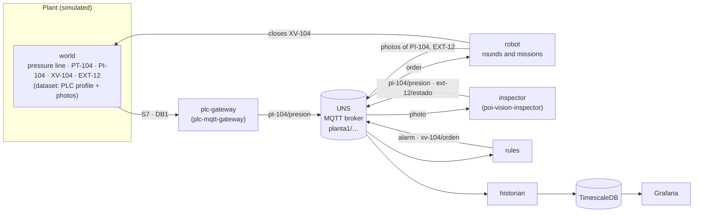

# Industrial UNS demo

[](https://github.com/aseinotegi/industrial-uns-demo/actions/workflows/ci.yml)


**English** · [Español](README.es.md)

A **Unified Namespace** for a small plant, running on your laptop with one command. A robot photographs a gauge and an extinguisher, a multimodal model reads the photos, a PLC transmitter publishes the same pressure, a rule cross-checks them, the robot closes a manual valve and everything ends up in a historian with a dashboard.

It is the story told on [andersein.com](https://andersein.com), working: no hardware, no cloud, real protocols.



## Quick start

```bash
docker compose up --build
```

Open **http://localhost:3000** (Grafana, no login). Every three minutes the line pressure rises from 4.2 towards 6.8 bar, following [dataset/plc/linea-104.csv](dataset/plc/linea-104.csv). Within a minute you will see the alarm confirmed by both sources, the robot closing XV-104 and the pressure falling back.

Too slow for a first look? `WORLD_TIME_SCALE=0.25 ROBOT_ROUND_S=4 docker compose up --build` runs the whole story in under a minute.

The namespace, right now:

```text
$ docker compose run --rm tree
planta1/
  exterior/
    pi-104/
      presion                 6.50 bar   (inspector, 94%)
    pt-104/
      alarma-alta             True
      presion                 6.00 bar
    reglas/
      sobrepresion-linea-104  activa   (rules)
    xv-104/
      estado                  cerrada   (robot-01)
  robots/
    robot-01/
      mision                  completada   (robot-01)
  servicios/
    historian                 online   (historian)
    ...
```

And what the historian keeps, one alarm from start to end (real output of a run):

```text
16:28:54.920 | planta1/robots/robot-01/foto                   | IMG_0413
16:28:54.924 | planta1/exterior/reglas/sobrepresion-linea-104 | activa
16:28:54.924 | planta1/exterior/xv-104/orden                  | cerrar
16:28:54.926 | planta1/robots/robot-01/mision                 | en-camino
16:28:57.428 | planta1/exterior/xv-104/estado                 | cerrada
16:28:57.429 | planta1/robots/robot-01/mision                 | completada
16:28:58.381 | planta1/exterior/reglas/sobrepresion-linea-104 | normal
```

## The story, service by service

| Step | Service | What it does |
|---|---|---|
| 1 | `robot` | Every round it stops at local gauge **PI-104** (a dial with no signal) and extinguisher **EXT-12** and takes a photo of each |
| 2 | `inspector` | [poi-vision-inspector](https://github.com/aseinotegi/poi-vision-inspector) reads each photo with a multimodal model: value, confidence and its own checks. Doubtful photos are published as `quality: uncertain`, unreadable ones never overwrite the last value |
| 3 | `plc-gateway` | Reads transmitter **PT-104** from the Siemens S7 PLC and publishes it to its UNS path |
| 4 | `rules` | Vision **and** PLC above 6 bar, both recent → alarm confirmed, order `cerrar` for XV-104 |
| 5 | `robot` | Goes to manual valve **XV-104** (no actuator) and closes it. Reports the new position |
| 6 | `historian` | Stores every value and event in TimescaleDB. Grafana shows the peak, the alarm and the closing |

`world` plays the physical plant: the pressure line, the PLC (a real S7 server on port 1102), what the robot's camera sees, the valve and the extinguisher. It is the only thing that is not software in real life.

The rules also watch the extinguisher: if the robot sees EXT-12 missing or with low pressure, `extintor-ext-12` raises a notice (no order).

## The dataset

What the plant "does" comes from files, so every run tells the same story and it is easy to change:

- [dataset/plc/linea-104.csv](dataset/plc/linea-104.csv): the line pressure over one cycle with XV-104 open. The PLC publishes it with a little electrical noise. Closing the valve brings it down to 4.2 bar whatever the profile says.
- [dataset/fotos.csv](dataset/fotos.csv) and [dataset/fotos/](dataset/fotos): 19 photos with their true value. 15 of PI-104 every 0.25 bar from 4.0 to 7.0 (two of them with glare or blur, as an outdoor camera gets) and 4 of EXT-12 (fine, low pressure, missing). In each round the camera hands over the photo closest to what the dial shows, so the photo and the PLC always agree.

The photos are synthetic, made with the generator of poi-vision-inspector (`python scripts/make_dataset.py`). Real photos replace them without touching code: drop the file in `dataset/fotos` and add its line, with the value you read, to `fotos.csv`.

### Which model reads the photos

| | Model | For |
|---|---|---|
| `config/inspector.yaml` (default) | none: recorded answers ([respuestas-de-prueba.json](dataset/respuestas-de-prueba.json)), written from the true values. Every result says `model: replay` | CI, a first run with nothing to install |
| `config/inspector.ollama.yaml` | `qwen3-vl` in [Ollama](https://ollama.com) on your PC (uses its GPU) | the real thing, nothing leaves the machine |

```bash
ollama pull qwen3-vl
INSPECTOR_CONFIG=inspector.ollama.yaml ROBOT_ROUND_S=30 docker compose up --build
```

A local model needs a few seconds per photo (more without a GPU), so give the robot time between rounds with `ROBOT_ROUND_S`.

## The namespace

One hierarchy, `site/area/device/value`, named like the plant's P&ID (in Spanish, as in the plant; the code is in English):

| Topic | Published by | Retained | Example value |
|---|---|---|---|
| `planta1/exterior/pi-104/presion` | inspector | yes | `6.75` bar, confidence 0.94 |
| `planta1/exterior/pi-104/presion/inspeccion` | inspector | yes | the whole inspection: checks, model, prompt and image hash |
| `planta1/exterior/ext-12/estado` | inspector | yes | `OK` / `NOK`, with the reason |
| `planta1/exterior/pt-104/presion` | plc-gateway | yes | `6.71` bar |
| `planta1/exterior/pt-104/alarma-alta` | plc-gateway | yes | `true` (the PLC's own bit) |
| `planta1/exterior/reglas/<rule>` | rules | yes | `activa` / `normal`, with the inputs that decided |
| `planta1/exterior/xv-104/orden` | rules | **no** | `cerrar` |
| `planta1/exterior/xv-104/estado` | robot | yes | `abierta` / `cerrada` |
| `planta1/robots/robot-01/foto` | robot | no | `IMG_0412`, with `poi` and `image_url` |
| `planta1/robots/robot-01/mision` | robot | yes | `en-camino` / `completada` |
| `planta1/servicios/<service>` | each service | yes | `online` / `offline` (Last Will) |

Every message follows one contract. Only `value` is mandatory, extra fields are kept:

```json
{"value": 6.8, "unit": "bar", "ts": "2026-11-18T15:28:54.920Z",
 "source": "inspector", "quality": "good", "confidence": 0.94, "model": "qwen3-vl"}
```

## Rules

Plain YAML, readable by whoever runs the plant ([config/rules.yaml](config/rules.yaml)):

```yaml
- id: sobrepresion-linea-104
  mode: act                 # notify: alarm only · act: alarm + orders
  when:                     # all of them, each one recent enough
    - { topic: planta1/exterior/pi-104/presion, above: 6.0, max_age_s: 45, quality: good }
    - { topic: planta1/exterior/pt-104/presion, above: 6.0, max_age_s: 30 }
  clear_when:               # hysteresis: clears below 5.5, not 6.0
    - { topic: planta1/exterior/pt-104/presion, below: 5.5 }
  on_trigger:
    - { topic: planta1/exterior/xv-104/orden, value: cerrar }
```

## Design decisions

- **The UNS is the only interface.** No service calls another. The inspector does not know the rules exist; the rules do not know the value came from a camera. Adding a second robot or a third plant means publishing under a new branch.
- **Two sources before acting.** A single bad photo or a noisy transmitter never sends a robot. Uncertain photos are published (the dashboard can show them) but rules require `quality: good`.
- **Freshness is measured by the receiver.** `max_age_s` uses the rule engine's clock at arrival, not the timestamp in the payload, so a device with a wrong clock cannot fake a recent value. Retained values are history, so they never trigger a rule.
- **Orders are not retained.** States are (a late subscriber gets the current picture), orders are not: a robot that restarts must not replay yesterday's `cerrar`.
- **Fire once, clear with margin.** An active rule does not fire again until it clears, and it clears at 5.5 bar, not 6.0. No order storms around the threshold.
- **Notify first, act later.** Same file, one word. That is how automatic actions earn trust in a plant.
- **Reuse, not copy.** The PLC side is [plc-mqtt-gateway](https://github.com/aseinotegi/plc-mqtt-gateway), built straight from its repository. Its per-tag `topic` option puts the PLC value at its UNS path.
- **Historian that survives restarts.** Batched inserts (one transaction per second), rows kept in memory while the database restarts, schema created on start. TimescaleDB hypertables when available, plain PostgreSQL otherwise.

## Project layout

```text
src/uns_demo/
  uns.py        the namespace and the message contract
  bus.py        MQTT for every service: Last Will status, retained or live-only subscriptions
  world.py      simulated plant: PLC profile, S7 PLC (DB1), camera from the dataset, valve
  robot.py      rounds and missions
  rules.py      YAML rules, pure engine (messages in, messages out)
  historian.py  UNS → TimescaleDB, batched and resilient
  tree.py       prints the namespace
config/         rules, gateway tags, inspector (replay / Ollama), broker
dataset/        photos with their true values, PLC pressure profile, recorded answers
grafana/        datasource and dashboard, provisioned
scripts/        end-to-end smoke test (used by CI), dataset generator
```

## Tests

```bash
pip install -e ".[dev]"
pytest -q                  # 59 tests, no broker or database needed
./scripts/smoke-test.sh    # the whole stack in Docker, checked end to end
```

CI runs the unit tests on Python 3.10–3.13 and then the full `docker compose` stack, waiting until the database shows the whole chain: alarm, order, valve closed, alarm cleared.

## Part of a series

| Repository | Role in the story |
|---|---|
| [plc-mqtt-gateway](https://github.com/aseinotegi/plc-mqtt-gateway) | PLC → MQTT, used here for PT-104 |
| [robot-fleet-watchdogs](https://github.com/aseinotegi/robot-fleet-watchdogs) | Rules and watchdogs for a real robot fleet |
| [andersein.com](https://andersein.com) | The story, drawn |

---

MIT License · [Ander Sein](https://andersein.com) · [aseinotegi@gmail.com](mailto:aseinotegi@gmail.com)
